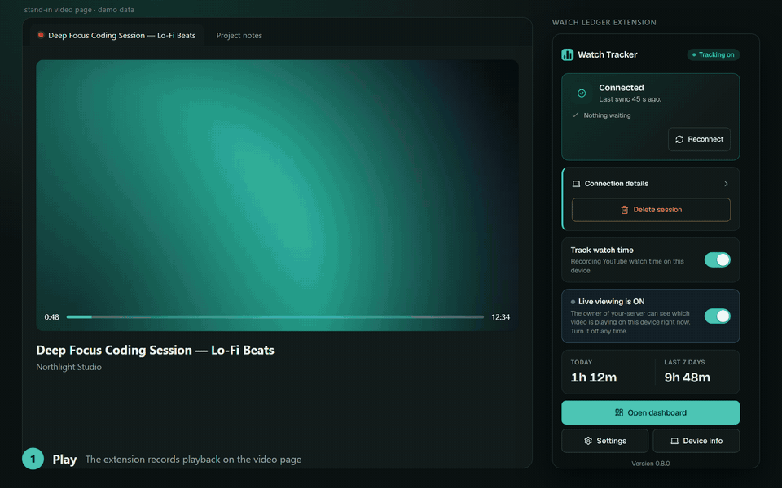
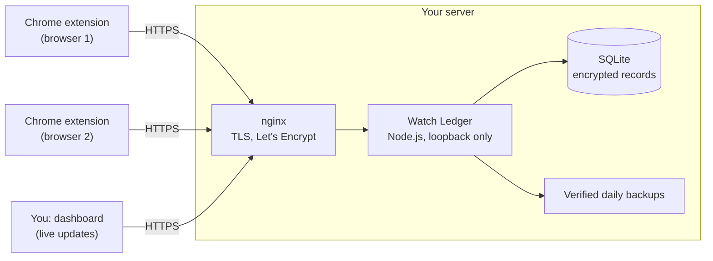
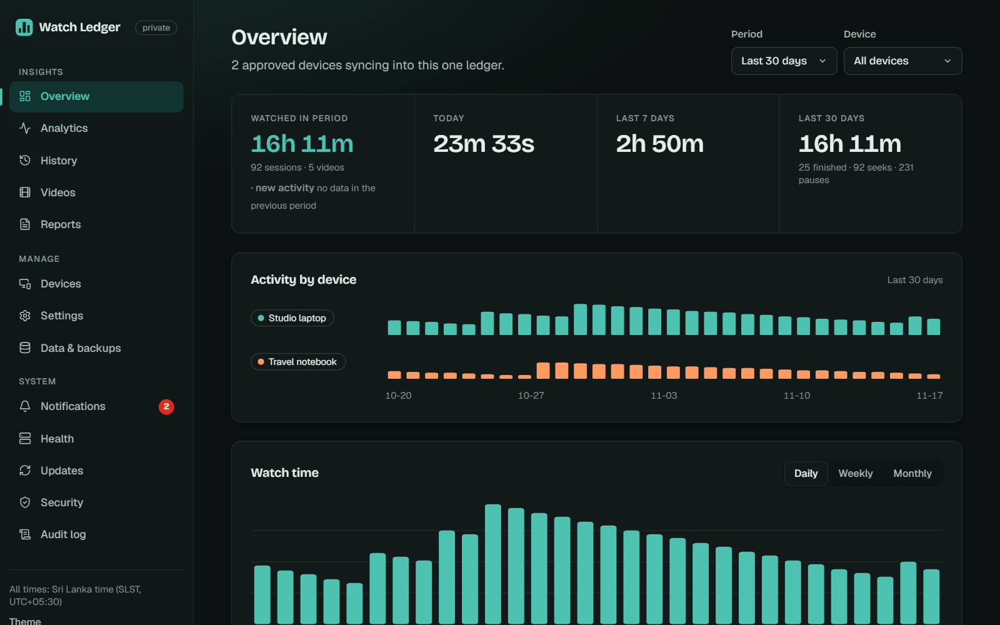
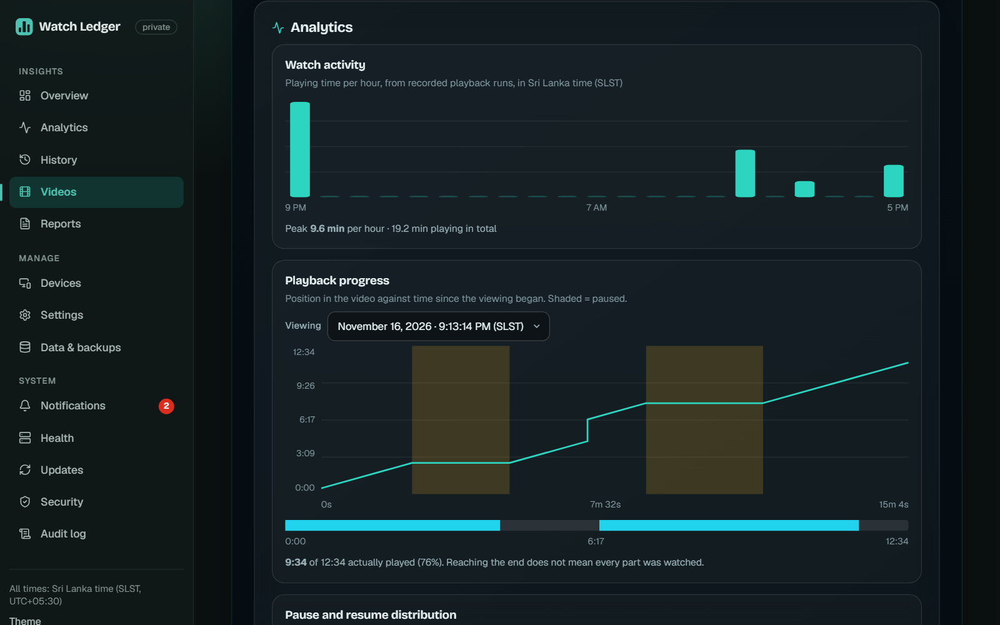
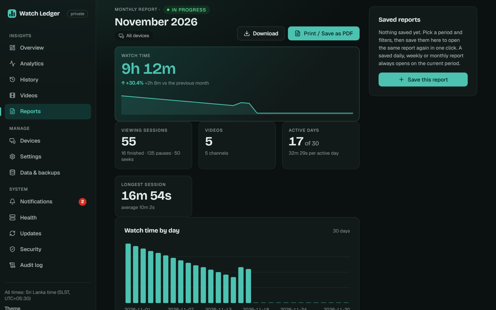
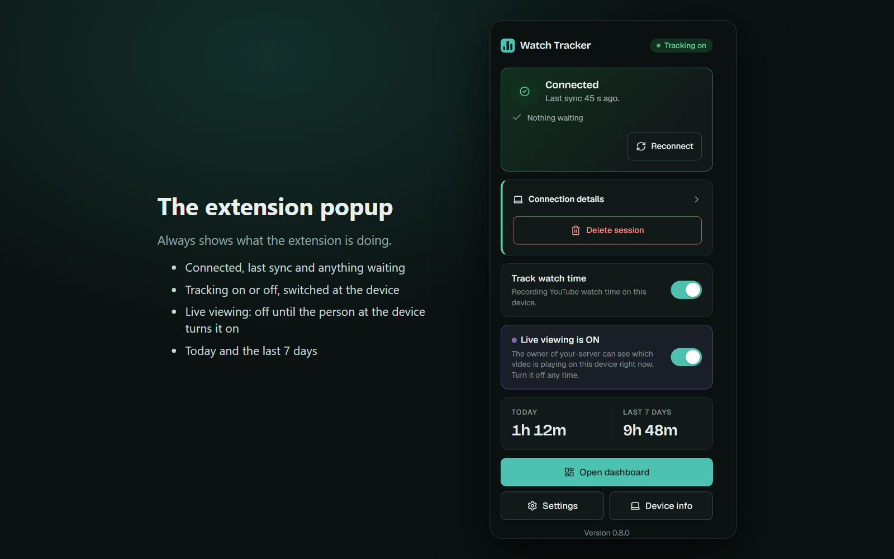

<div align="center">


# Watch Ledger

**A private, self-hosted ledger of your YouTube viewing: every device, every pause, one dashboard you own.**

[](https://github.com/NimeshPiyathissa/YT-WATCH-LEDGER/releases/tag/v0.8.0)
[](https://github.com/NimeshPiyathissa/YT-WATCH-LEDGER/actions/workflows/ci.yml)
[](LICENSE)
[](docs/EXTENSION_SETUP.md)
[](docs/VPS_DEPLOYMENT.md)
[](SECURITY.md)
[](docs/VPS_DEPLOYMENT.md)

[Download v0.8.0](https://github.com/NimeshPiyathissa/YT-WATCH-LEDGER/releases/tag/v0.8.0) · [Quick install](#quick-install) · [Upgrading from v0.7.0](#upgrading-from-v070) · [Known issues](docs/KNOWN_ISSUES.md) · [Docs](#documentation)



<sub>Real v0.8.0 interface with fictional demo data. The video page in the first frames is a neutral stand-in, not YouTube.</sub>

</div>

---

## Highlights

| | |
|---|---|
| **Live Video Details** | Open any video for its live status (`LIVE WATCHING`, `PAUSED — 00:12:41`, `COMPLETED`), a timeline of every play, pause, seek and tab switch, a pause-and-resume table to the second, and per-video charts. |
| **Every device, one ledger** | Pair as many browsers as you like. Each one is a revocable session with its own diagnostics, activity log and consent state. |
| **Reports Studio** | Daily, weekly, monthly and custom reports with overlapping playback counted once. Save them, and export to CSV, JSON or PDF. |
| **Private by design** | Records are encrypted at rest with AES-256-GCM, and the admin password is hashed with argon2id. One owner, no sign-up page, no third-party analytics, no cloud account. |
| **Consent you can see** | The popup always shows what the extension is doing. Live viewing is **off** until the person at the device turns it on ([how it works](docs/LIVE_MONITORING.md)). |
| **Operations built in** | Guided installer with HTTPS, verified daily backups, an Update Manager with update history and rollback commands, a Health Center and an audit log. |

## How it works

1. **Record.** The Chrome extension observes playback on `youtube.com` (play, pause, resume, seek, buffering, tab switches, end of viewing). Events are queued offline and uploaded exactly once.
2. **Sync.** Each paired browser syncs over HTTPS to **your** server, and only to the server it was paired with.
3. **See.** The dashboard updates live and keeps one encrypted history across all your devices.



## Screenshots

<table>
  <tr>
    <td width="50%"><br><b>Overview</b>: every device, every day</td>
    <td width="50%"><br><b>Video Details</b>: per-video charts and progress</td>
  </tr>
  <tr>
    <td width="50%"><br><b>Reports Studio</b>: daily, weekly, monthly, custom</td>
    <td width="50%"><br><b>Extension popup</b>: always-visible state</td>
  </tr>
</table>

<sub>All screenshots show fictional demo data. The server address in the popup is shown as a placeholder.</sub>

## Quick install

### 1. Self-hosted server

You need an Ubuntu 22.04 or 24.04 server, a domain pointing at it ([beginner guide](docs/DOMAIN_SETUP.md)), and about 15 minutes.

```bash
# download v0.8.0 and check it against the published checksums
curl -LO https://github.com/NimeshPiyathissa/YT-WATCH-LEDGER/releases/download/v0.8.0/watch-ledger-v0.8.0.tar.gz
curl -LO https://github.com/NimeshPiyathissa/YT-WATCH-LEDGER/releases/download/v0.8.0/SHA256SUMS
sha256sum -c SHA256SUMS --ignore-missing
tar -xzf watch-ledger-v0.8.0.tar.gz && cd watch-ledger-v0.8.0

sudo ./install.sh --dry-run     # preview; changes nothing
sudo ./install.sh               # the guided 8-step installer
```

The installer:
- asks for your admin email, a strong password and your domain
- generates the encryption keys
- installs Node.js, a hardened `systemd` service and nginx
- obtains and auto-renews a Let's Encrypt certificate, and turns on the firewall
- builds an extension that already points at your server

It can be re-run and resumed (`--resume`). It never regenerates an existing key or overwrites a database.

> [!IMPORTANT]
> After installing v0.8.0, run `sudo chown -R root:root /opt/watch-ledger/node`. The bundled Node.js is otherwise owned by the login user (known issue [A33](docs/KNOWN_ISSUES.md#12-fresh-installs-nodejs-file-owners-staging-certificates-nginxs-default-site), fix planned).

Details: [VPS deployment](docs/VPS_DEPLOYMENT.md) · [HTTPS](docs/SSL_SETUP.md) · [Try it locally first](docs/DEMO.md)

### 2. Chrome extension

1. Download `yt-watch-tracker-v0.8.0.zip` and `SHA256SUMS` from the [v0.8.0 release](https://github.com/NimeshPiyathissa/YT-WATCH-LEDGER/releases/tag/v0.8.0), and check the ZIP with `sha256sum -c SHA256SUMS --ignore-missing`. Or use the ZIP the installer built for your domain.
2. Unzip it, open `chrome://extensions`, turn on **Developer mode** and choose **Load unpacked**.
3. In the dashboard, open **Devices**, create a pairing code and enter it in the extension ([pairing guide](docs/DEVICE_PAIRING.md)).

Manifest V3, Chrome 116 or later. It is not on the Chrome Web Store. Setup details: [EXTENSION_SETUP.md](docs/EXTENSION_SETUP.md).

| Permission | Why |
|---|---|
| `storage`, `alarms` | Settings, pairing state and the sync timer (idle until paired) |
| `https://www.youtube.com/*` | Observes playback on YouTube, and nothing else |
| Your server's address (optional) | Requested at pairing, for that one server only; removed when you unpair |

## Upgrading from v0.7.0

v0.7.0's `update.sh` must be run with `bash`. It takes a verified backup first, applies three additive migrations, and switches the code back by itself if the new version is not healthy.

```bash
cd /opt/watch-ledger/current
sudo bash scripts/update.sh --version v0.8.0 --dry-run   # what would happen; changes nothing
sudo bash scripts/update.sh --version v0.8.0
sudo bash scripts/health-check.sh
```

Then update the extension on each browser: unzip `yt-watch-tracker-v0.8.0.zip` **over the folder it was loaded from** and reload it. Loading it from a new folder would lose the pairing.

| Coming from | Notes |
|---|---|
| **v0.7.0** | As above. New dashboard pages: Reports, Updates, Settings, Notifications, Security, Health. Live viewing starts **off** on every device. |
| **v0.8.0-rc.1** | `sudo ./scripts/update.sh --version v0.8.0`. If rc.1 runs from a folder named `0.8.0`, skip `--dry-run` ([A36](docs/KNOWN_ISSUES.md#13-updating-rc1--v080-skip---dry-run-when-rc1-is-in-a-folder-named-080-a36)); the real update works. |

Full guide, including rollback: [UPGRADING.md](docs/UPGRADING.md) · Release notes: [CHANGELOG.md](CHANGELOG.md)

## Known limitations

| | |
|---|---|
| **A33** (security) | After `install.sh`, the bundled Node.js is owned by uid 1000; use the one-line workaround above. A fix is planned. |
| **A34** | With `--staging-cert`, the installer's final check and `health-check.sh` report HTTPS as failed (untrusted staging certificate). The installation itself works. |
| **A35** | nginx's default page stays enabled on the server's bare IP address. |
| **Remote resume** | The owner can turn tracking back on after the person at the device paused it. It is visible on the device and audited, but it conflicts with user-controlled consent. |
| **What playback means** | Player events cannot prove a person was watching: "active" means the player was playing, outside ads. |
| **Install method** | Developer-mode install only; there is no Chrome Web Store listing. |
| **Not yet verified** | A production certificate on a real domain (tested with a Let's Encrypt staging certificate), and the code-only rollback to v0.7.0. |

The full list, with workarounds: **[docs/KNOWN_ISSUES.md](docs/KNOWN_ISSUES.md)**

## Responsible use

> Use Watch Ledger on **your own devices**, or with the **knowledge and agreement of everyone it records** (for example, a parent with a child's informed awareness). It is not designed or supported for covert monitoring. The operator is responsible for lawful use. No warranty.

## Security

- HTTPS only. The app listens on loopback behind nginx, and secrets never appear on a command line or in the repository.
- Stored records are encrypted with AES-256-GCM using `MASTER_KEY`. The admin password uses argon2id, and the database enforces a single owner.
- Device credentials, refresh tokens and pairing codes are stored only as hashes, and revoking a device takes effect immediately.
- CSP, strict cookies, CSRF origin checks, rate limits, an audit log and ownership checks on every route.
- A `systemd` unit with `NoNewPrivileges`, `ProtectSystem=strict` and a dedicated unprivileged user.

What the code enforces, and what is the operator's job: [SECURITY.md](SECURITY.md). **Back up `MASTER_KEY` separately from your backups**: without it the data cannot be read.

## Maintenance

| Task | Command |
|---|---|
| Health check (cron-friendly exit codes) | `sudo ./scripts/health-check.sh` |
| Back up now (never pruned) | `sudo ./scripts/backup.sh` |
| Restore | `sudo ./scripts/restore.sh --list`, then `sudo ./scripts/restore.sh <file>` |
| Check for an update / update | `sudo ./scripts/update.sh --check` / `sudo ./scripts/update.sh --version vX.Y.Z` |
| Smoke-test a deployment | `node scripts/smoke-test.mjs --url https://your.domain --anonymous` |

Run them from `/opt/watch-ledger/current`. Details: [Backup & recovery](docs/BACKUP_RECOVERY.md) · [Operations](docs/OPERATIONS.md) · [Troubleshooting](docs/TROUBLESHOOTING.md)

## Documentation

| Topic | Guide |
|---|---|
| Install | [INSTALLATION.md](docs/INSTALLATION.md) · [VPS_DEPLOYMENT.md](docs/VPS_DEPLOYMENT.md) · [DOMAIN_SETUP.md](docs/DOMAIN_SETUP.md) · [SSL_SETUP.md](docs/SSL_SETUP.md) · [DEPLOYMENT.md](docs/DEPLOYMENT.md) (manual) |
| Extension and devices | [EXTENSION_SETUP.md](docs/EXTENSION_SETUP.md) · [DEVICE_PAIRING.md](docs/DEVICE_PAIRING.md) · [SYNC_ENGINE.md](docs/SYNC_ENGINE.md) · [LIVE_MONITORING.md](docs/LIVE_MONITORING.md) |
| Dashboard | [ADMIN_DASHBOARD.md](docs/ADMIN_DASHBOARD.md) · [VIDEO_DETAILS.md](docs/VIDEO_DETAILS.md) · [REPORTS.md](docs/REPORTS.md) · [NOTIFICATIONS.md](docs/NOTIFICATIONS.md) · [SETTINGS.md](docs/SETTINGS.md) · [SECURITY_CENTER.md](docs/SECURITY_CENTER.md) |
| Operations | [PRODUCTION_GUIDE.md](docs/PRODUCTION_GUIDE.md) · [OPERATIONS.md](docs/OPERATIONS.md) · [BACKUP_RECOVERY.md](docs/BACKUP_RECOVERY.md) · [UPDATES.md](docs/UPDATES.md) · [UPGRADING.md](docs/UPGRADING.md) · [TROUBLESHOOTING.md](docs/TROUBLESHOOTING.md) |
| Reference | [FEATURES.md](docs/FEATURES.md) · [KNOWN_ISSUES.md](docs/KNOWN_ISSUES.md) · [RELEASING.md](docs/RELEASING.md) · [CHANGELOG.md](CHANGELOG.md) · [SECURITY.md](SECURITY.md) |
| Contributing | [CONTRIBUTING.md](CONTRIBUTING.md) · manual test lists: [general](docs/MANUAL_TEST_CHECKLIST.md), [Video Details](docs/MANUAL_TEST_CHECKLIST_VIDEO_DETAILS.md), [extension](docs/MANUAL_TEST_CHECKLIST_EXTENSION.md) |

<details>
<summary><b>Development and tests</b></summary>

```bash
git clone https://github.com/NimeshPiyathissa/YT-WATCH-LEDGER.git && cd YT-WATCH-LEDGER
cd server && npm ci && cp .env.example .env     # fill in the two generated secrets; see the comments in the file
node --env-file=.env src/server.js              # local server (BASE_URL=http://localhost:PORT, NODE_ENV not production)
```

Load the repository root as an unpacked extension for development. Tests:

```bash
for f in tests/*.test.js; do node "$f"; done    # extension
cd server && npm ci && npm test                  # server, end-to-end and installer suites (needs bash)
node scripts/check-links.mjs                     # documentation links
```

Stack: Chrome Manifest V3 with vanilla JavaScript and an IndexedDB outbox; Node.js 22, Fastify 5, better-sqlite3, argon2, Server-Sent Events; a dependency-free dashboard with inline SVG charts and no CDN; nginx, certbot, `systemd`, ufw. See [CONTRIBUTING.md](CONTRIBUTING.md).

</details>

## License

[MIT](LICENSE) © 2026 Nimesh Piyathissa. Third-party fonts and icons: [THIRD_PARTY_NOTICES.md](THIRD_PARTY_NOTICES.md).

<div align="center"><sub><b>Powered by SciLink Project</b></sub></div>
