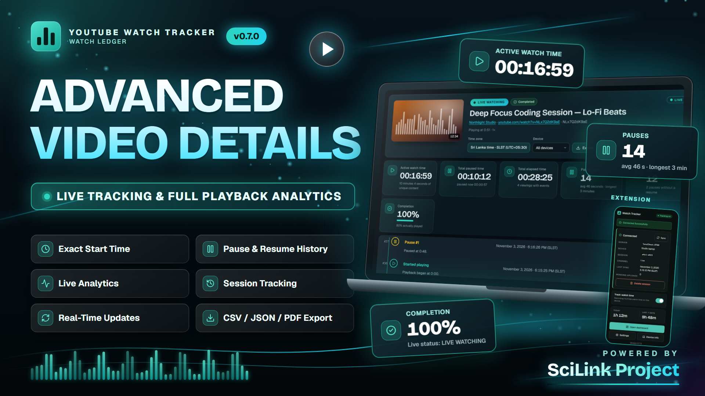
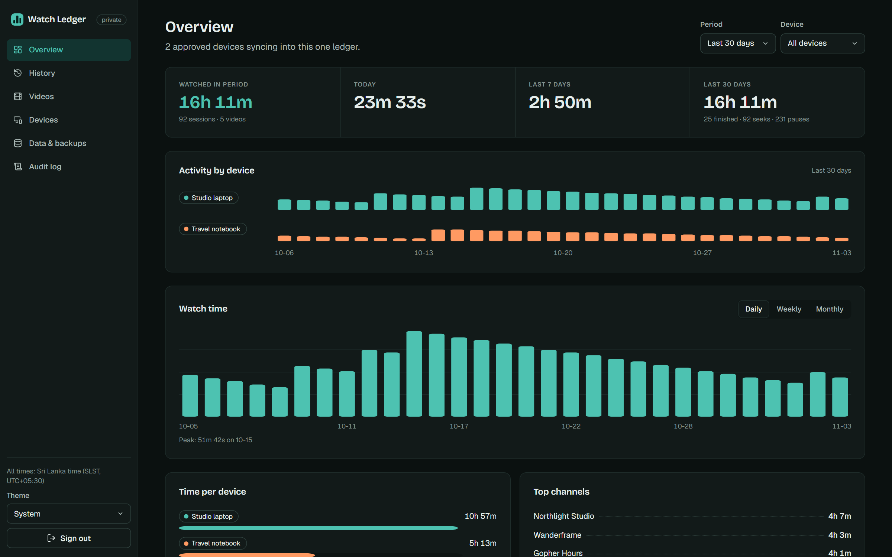
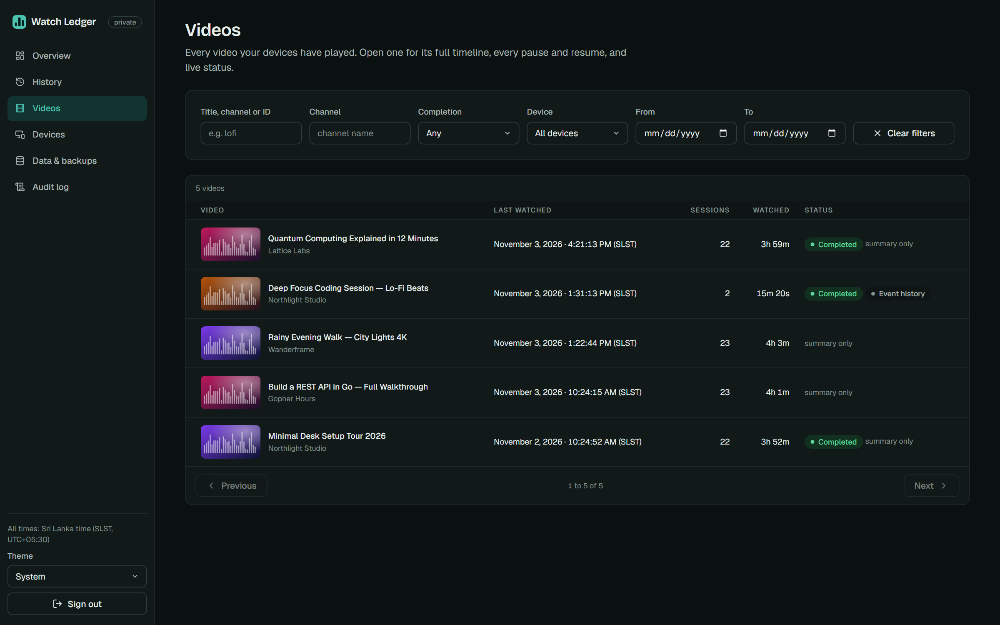
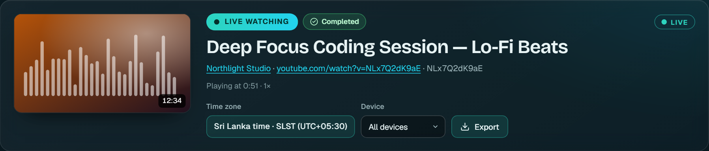
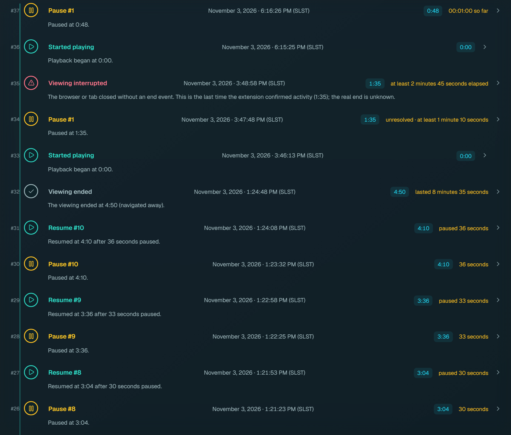
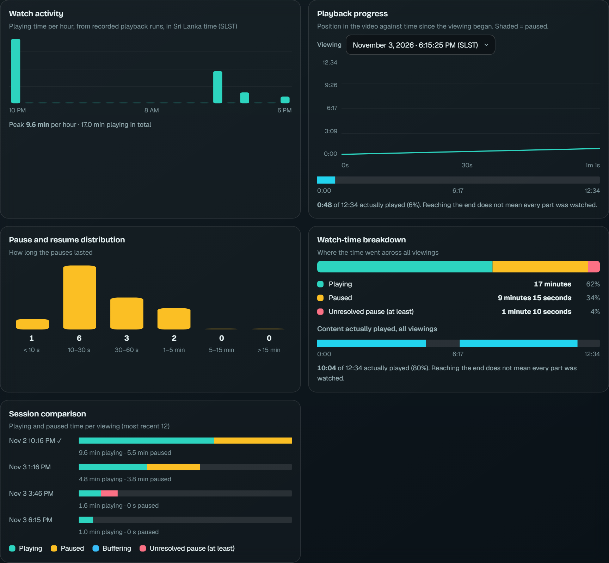
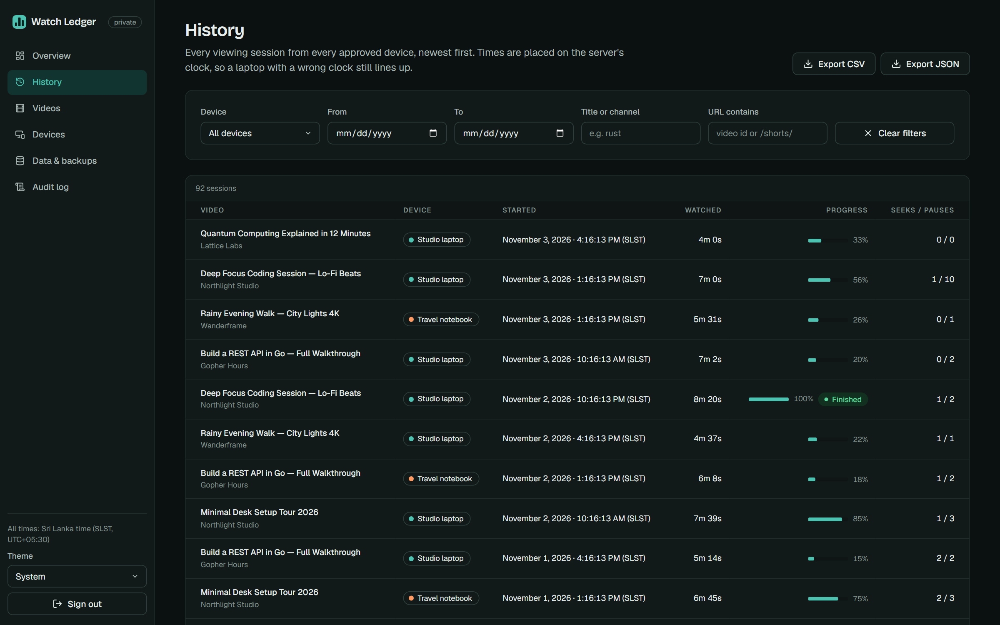
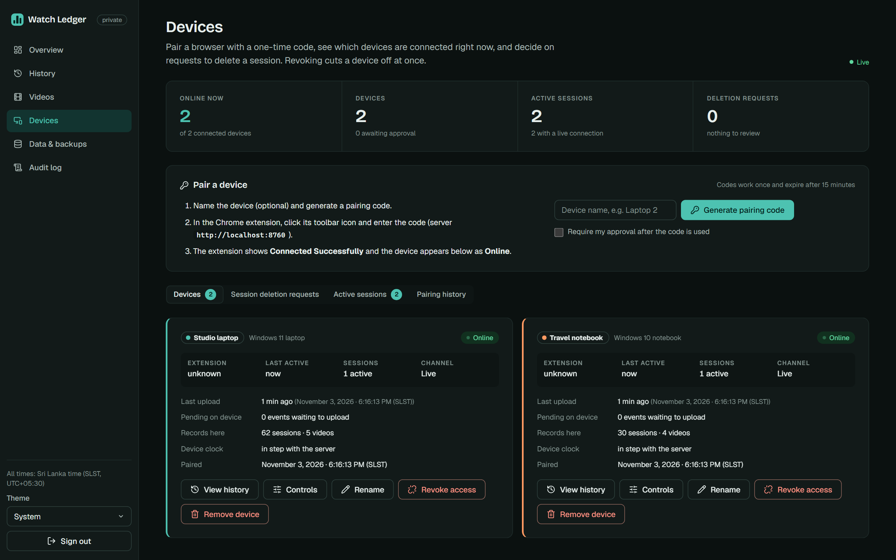
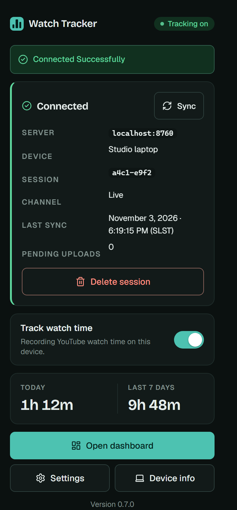
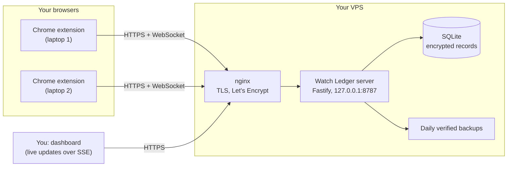

<div align="center">


**A private, self-hosted ledger of your YouTube viewing: every device, every pause, one dashboard you own.**

[](LICENSE)
[](CHANGELOG.md)
[](docs/EXTENSION_SETUP.md)
[](docs/VPS_DEPLOYMENT.md)
[](SECURITY.md)
[](docs/VPS_DEPLOYMENT.md)

[Quick start](#quick-start) · [VPS deployment](docs/VPS_DEPLOYMENT.md) · [Extension](docs/EXTENSION_SETUP.md) · [Video Details](docs/VIDEO_DETAILS.md) · [Security](SECURITY.md) · [All docs](#documentation)

<a href="https://github.com/NimeshPiyathissa/YT-WATCH-LEDGER/releases/tag/v0.7.0">
  
</a>

<sub>Powered by SciLink Project</sub>

</div>

---

## What it is

Watch Ledger is a **Chrome extension** plus a **small server you run yourself**. The extension records how you watch YouTube on each of your browsers; the server keeps one encrypted history and shows it in a live dashboard. No third-party analytics, no cloud account, no one else's server.

- **Your devices, one ledger.** Pair as many browsers as you like; each is a revocable session.
- **Video Details.** Click any video for a live page: `LIVE WATCHING`, `PAUSED — 00:12:41`, `COMPLETED`, `DEVICE OFFLINE`; a timeline of every pause, resume, seek and buffering interval; five charts; CSV / JSON / printable-report export.
- **Private by design.** Records are AES-256-GCM encrypted at rest; the admin password is argon2id; one owner, no sign-up page.
- **Visible, consent-first.** The extension shows a `REC` badge, the popup always shows the connection, and sync starts only when someone at the browser enters a pairing code and grants the permission prompt.
- **Consent you can see.** Live viewing (what is playing right now) is **off** until the person at the device turns it on; the extension then shows it in the popup and on the toolbar badge ([how it works](docs/LIVE_MONITORING.md)).
- **Self-hosting that does not need a sysadmin.** A guided installer sets up the server, HTTPS and automatic renewal on a fresh Ubuntu VPS.

## Responsible use

> Use Watch Ledger on **your own devices**, or with the **knowledge and agreement of everyone it records** (for example, a parent with a child's informed awareness). It is not designed or supported for covert monitoring. The operator is responsible for lawful use. No warranty.

## Screenshots

> The screenshots show the real interface populated with **fictional demo data**.

| | |
|---|---|
|  <br> **Overview** |  <br> **Videos** |
|  <br> **Video Details: live status** |  <br> **Every pause and seek, on a timeline** |
|  <br> **Charts** |  <br> **History** |
|  <br> **Devices and one-time pairing codes** |  <br> **Extension popup: always visible state** |

## How it fits together



## Quick start

You need an Ubuntu 22.04 / 24.04 VPS, a domain pointing at it ([beginner guide](docs/DOMAIN_SETUP.md)), and about 15 minutes.

```bash
git clone https://github.com/NimeshPiyathissa/YT-WATCH-LEDGER.git
cd YT-WATCH-LEDGER
sudo bash install.sh --dry-run     # preview; changes nothing
sudo bash install.sh               # the 8-step wizard
```

The wizard asks for your admin email and a strong password, then your domain; it generates the encryption keys, installs Node.js, a hardened `systemd` service and nginx, obtains and auto-renews a Let's Encrypt certificate, and builds an extension already pointing at your server. It is safe to re-run and `--resume`-able; it never regenerates an existing key or overwrites a database.

Then: open `https://your.domain`, [install the extension](docs/EXTENSION_SETUP.md), and [pair it](docs/DEVICE_PAIRING.md).

Want to try it first on your own computer? See the [local demo](docs/DEMO.md).

> **Honest status.** The installer's logic is covered by a 102-check automated sandbox suite, and its steps that need a real machine (`apt`, `systemd`, `nginx`, `certbot`, `ufw`) are shell-checked and dry-run planned but have **not yet been run on a real VPS by the author**. Treat v0.7.0 as a pre-release and use `--dry-run` first. Details: [VPS deployment](docs/VPS_DEPLOYMENT.md#deploy-on-an-ubuntu-vps-guided-installer).

## Technology stack and requirements

| Layer | Technology |
|---|---|
| Extension | Chrome Manifest V3, vanilla JavaScript, IndexedDB event outbox (Chrome 116+) |
| Server | Node.js 22, Fastify 5, better-sqlite3 (SQLite), argon2, WebSocket and Server-Sent Events |
| Dashboard | Dependency-free JavaScript, inline SVG charts, no CDN |
| Deployment | nginx, Let's Encrypt (certbot), systemd, ufw |

**Server requirements:** Ubuntu 22.04 or 24.04 LTS, 1 vCPU, about 1 GB RAM and 5 GB disk, a public IPv4 address, ports 80/443 reachable, a domain or subdomain. One subdomain is all the application needs: the dashboard, API and extension all use the same address (no separate `dashboard.` / `api.` hosts; see [DOMAIN_SETUP.md](docs/DOMAIN_SETUP.md)). **Browser:** Chrome 116+ (or a Chromium browser that loads unpacked extensions).

## The Chrome extension

Manifest V3, Chrome 116+, installed from a ZIP in Developer mode (it is **not** on the Chrome Web Store). Download `yt-watch-tracker-v0.7.0.zip` and `SHA256SUMS` from the [latest release](https://github.com/NimeshPiyathissa/YT-WATCH-LEDGER/releases), or use the one the installer built for your domain. Steps: [Extension setup](docs/EXTENSION_SETUP.md).

| Permission | Why |
|---|---|
| `storage` | settings and pairing state |
| `alarms` | sync timer and connection check (idle unless paired) |
| `https://www.youtube.com/*` | observe playback on YouTube, and nothing else |
| optional: your server's origin | requested at pairing, for that one server, removed on unpair |

## Video Details

The **Videos** page lists everything you watched; opening one shows live status, an event timeline, a pause/resume table, viewing history, charts and exports, updating without a refresh. Capture is event-driven (pause, resume, seek, buffering, completion, tab switch, viewing end), queued offline in IndexedDB and uploaded exactly once. A *Collect watch detail* switch turns the detail off. How durations are computed, and what "unresolved" means: [docs/VIDEO_DETAILS.md](docs/VIDEO_DETAILS.md). All times are shown in Sri Lanka Standard Time (Asia/Colombo); storage is UTC.

## Security

- HTTPS only; the app listens on loopback behind nginx; secrets never appear on a command line or in the repository.
- AES-256-GCM encryption of stored records with `MASTER_KEY`; argon2id admin password; one owner enforced by the database.
- Device credentials, refresh tokens and pairing codes stored only as hashes; revoking a device is immediate.
- CSP, strict cookies, CSRF origin checks, rate limits, an audit log and ownership checks on every route (covered by an authorization sweep test).
- A systemd unit with `NoNewPrivileges`, `ProtectSystem=strict` and a dedicated unprivileged user.

What the code enforces, and what is the operator's job: [SECURITY.md](SECURITY.md). **Back up `MASTER_KEY` separately from your backups**: without it the data cannot be read.

## Maintenance

| Task | Command |
|---|---|
| Health check (cron-friendly exit codes) | `./scripts/health-check.sh` |
| Backup now (never pruned) | `sudo ./scripts/backup.sh` |
| Restore | `sudo ./scripts/restore.sh --list` then `sudo ./scripts/restore.sh <file>` |
| Update (backs up first, rolls code back if unhealthy) | `sudo ./scripts/update.sh --check` / `--version vX.Y.Z` |
| Smoke-test a deployment | `node scripts/smoke-test.mjs --url https://your.domain --anonymous` |

Details: [Backup & recovery](docs/BACKUP_RECOVERY.md), [Operations](docs/OPERATIONS.md), [Troubleshooting](docs/TROUBLESHOOTING.md).

## Promo videos

A cinematic 16:9 (75 s) and a vertical 9:16 (56 s) overview are attached to the [GitHub release](https://github.com/NimeshPiyathissa/YT-WATCH-LEDGER/releases/tag/v0.7.0) as `watch-ledger-cinematic-16x9.mp4` and `watch-ledger-social-9x16.mp4`. They use the real interface with fictional demo data.

## Troubleshooting

| Symptom | First step |
|---|---|
| Installer says the domain does not resolve | [DOMAIN_SETUP.md](docs/DOMAIN_SETUP.md), then `sudo bash install.sh --resume` |
| Dashboard shows `bad_origin` | open it at exactly the configured `https://your.domain` |
| Service will not start | `journalctl -u watch-ledger -n 80 --no-pager` |
| Extension will not pair | check the code is unexpired (15 min) and the address is HTTPS; [DEVICE_PAIRING.md](docs/DEVICE_PAIRING.md) |
| Anything else | `./scripts/health-check.sh`, [TROUBLESHOOTING.md](docs/TROUBLESHOOTING.md), [PRODUCTION_GUIDE.md](docs/PRODUCTION_GUIDE.md) |

## Documentation

| Topic | Guide |
|---|---|
| Choose an install path | [INSTALLATION.md](docs/INSTALLATION.md) |
| Ubuntu VPS with the installer | [VPS_DEPLOYMENT.md](docs/VPS_DEPLOYMENT.md) |
| Domain and DNS for beginners | [DOMAIN_SETUP.md](docs/DOMAIN_SETUP.md) |
| HTTPS certificates | [SSL_SETUP.md](docs/SSL_SETUP.md) |
| Chrome extension | [EXTENSION_SETUP.md](docs/EXTENSION_SETUP.md), [INSTALL.md](docs/INSTALL.md), [EXTENSION.md](docs/EXTENSION.md) |
| Pairing a browser | [DEVICE_PAIRING.md](docs/DEVICE_PAIRING.md) |
| Backups, restore, updates | [BACKUP_RECOVERY.md](docs/BACKUP_RECOVERY.md) |
| Day-two operations (update, change domain or admin password, logs, outages, uninstall) | [PRODUCTION_GUIDE.md](docs/PRODUCTION_GUIDE.md) |
| Manual (non-installer) deployment | [DEPLOYMENT.md](docs/DEPLOYMENT.md) |
| Admin dashboard | [ADMIN_DASHBOARD.md](docs/ADMIN_DASHBOARD.md) |
| Video Details | [VIDEO_DETAILS.md](docs/VIDEO_DETAILS.md) |
| Live viewing and consent | [LIVE_MONITORING.md](docs/LIVE_MONITORING.md) |
| How the extension syncs | [SYNC_ENGINE.md](docs/SYNC_ENGINE.md) |
| Upgrading and rolling back | [UPGRADING.md](docs/UPGRADING.md) |
| Update Manager (versions, update history, rollback commands) | [UPDATES.md](docs/UPDATES.md) |
| Reports Studio | [REPORTS.md](docs/REPORTS.md) |
| Building and publishing a release | [RELEASING.md](docs/RELEASING.md) |
| Full behaviour reference | [FEATURES.md](docs/FEATURES.md) |
| Known issues | [KNOWN_ISSUES.md](docs/KNOWN_ISSUES.md) |
| Manual browser test lists | [general](docs/MANUAL_TEST_CHECKLIST.md), [Video Details](docs/MANUAL_TEST_CHECKLIST_VIDEO_DETAILS.md), [extension](docs/MANUAL_TEST_CHECKLIST_EXTENSION.md) |
| Security | [SECURITY.md](SECURITY.md) |
| Contributing, changelog | [CONTRIBUTING.md](CONTRIBUTING.md), [CHANGELOG.md](CHANGELOG.md) |
| Background (academic origins) | [docs/project-notes/](docs/project-notes/SUBMISSION.md) |

## Tests

```bash
for f in tests/*.test.js; do node "$f"; done    # extension
cd server && npm ci && npm test                  # server, end-to-end, installer sandbox suite (needs bash)
node scripts/check-links.mjs                     # documentation links
```

## Development

```bash
git clone https://github.com/NimeshPiyathissa/YT-WATCH-LEDGER.git && cd YT-WATCH-LEDGER
cd server && npm ci && cp .env.example .env     # fill in two generated secrets; see the comments in the file
node --env-file=.env src/server.js              # local server (dev: BASE_URL=http://localhost:PORT, NODE_ENV not production)
```
Load the repository root as an unpacked extension for development. Shared pure modules are copied into the server by `node server/scripts/sync-shared.js`. See [CONTRIBUTING.md](CONTRIBUTING.md).

## Roadmap

Ideas, not promises: a real-VPS validation pass of the installer; a Chrome Web Store listing; a CI-built release pipeline; per-device export; removing the `resume_tracking` override (see below). Track or propose items in the repository's issues.

## Limitations

- **`resume_tracking` privacy limitation:** the owner can remotely turn tracking back on after the person at the device paused it. It is visible on the device and audited, but it conflicts with user-controlled consent; it was kept by the owner's decision and can be removed ([KNOWN_ISSUES.md](docs/KNOWN_ISSUES.md)).

- Player events cannot prove a human was watching; "active" means the player was in a playing, non-ad state.
- The extension can always be paused or removed at `chrome://extensions`; the server then shows the device as offline until you revoke it.
- Developer-mode install only; there is no Chrome Web Store listing and no approval is claimed.
- See [KNOWN_ISSUES.md](docs/KNOWN_ISSUES.md) for the full list.

## Changelog

See [CHANGELOG.md](CHANGELOG.md). v0.7.0 is the first public release.

## License and credits

[MIT](LICENSE) © 2026 Nimesh Piyathissa. Third-party fonts and icons: [THIRD_PARTY_NOTICES.md](THIRD_PARTY_NOTICES.md).

**Powered by SciLink Project.**
